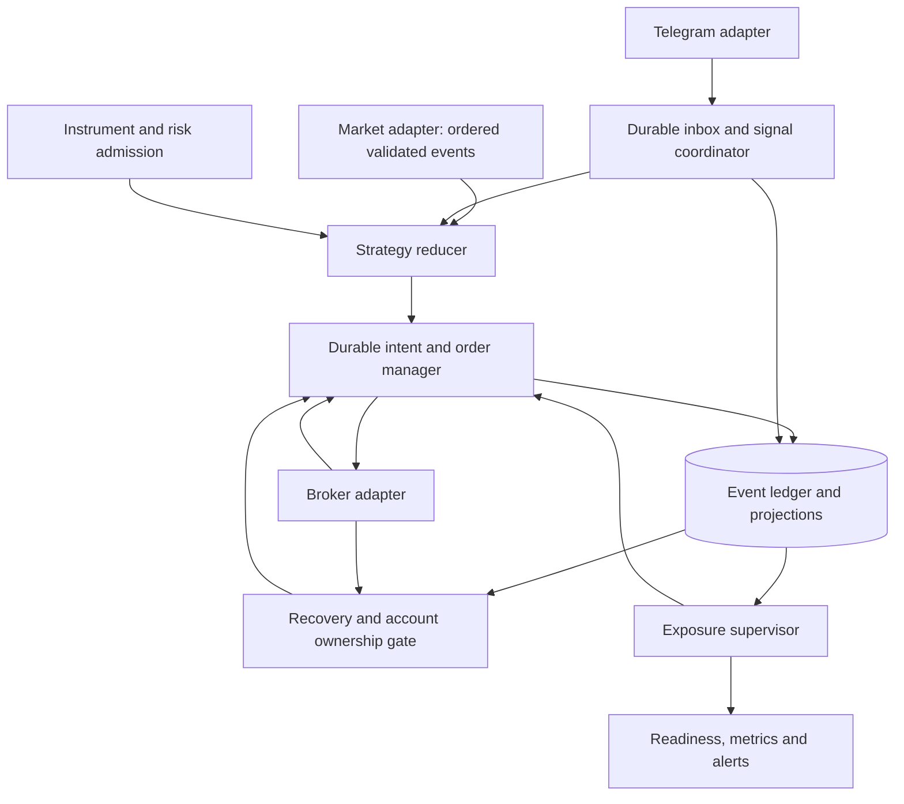
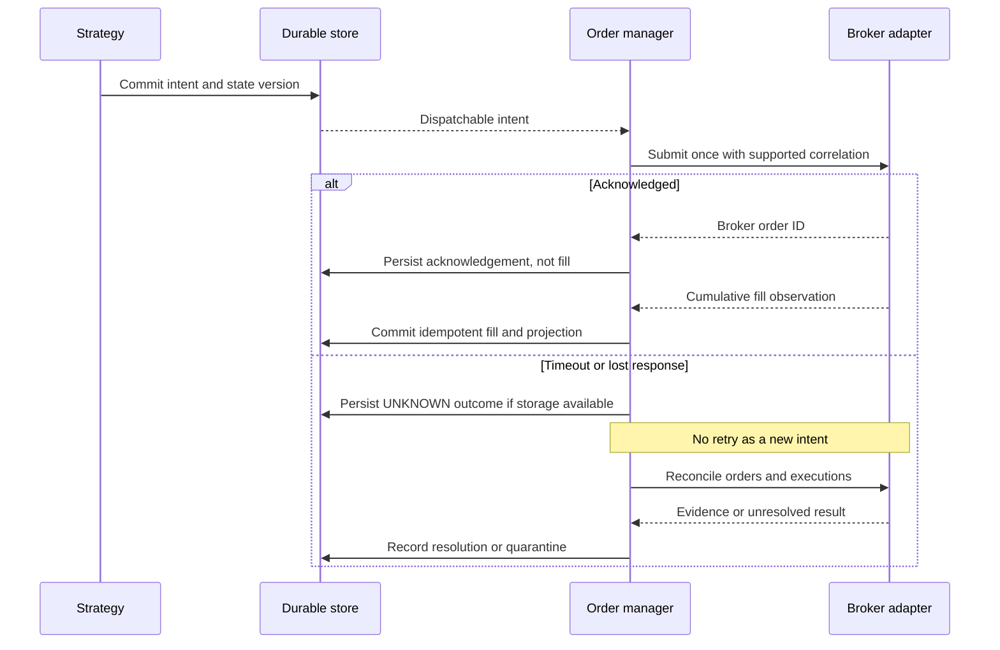
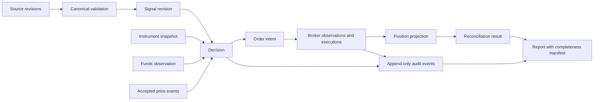
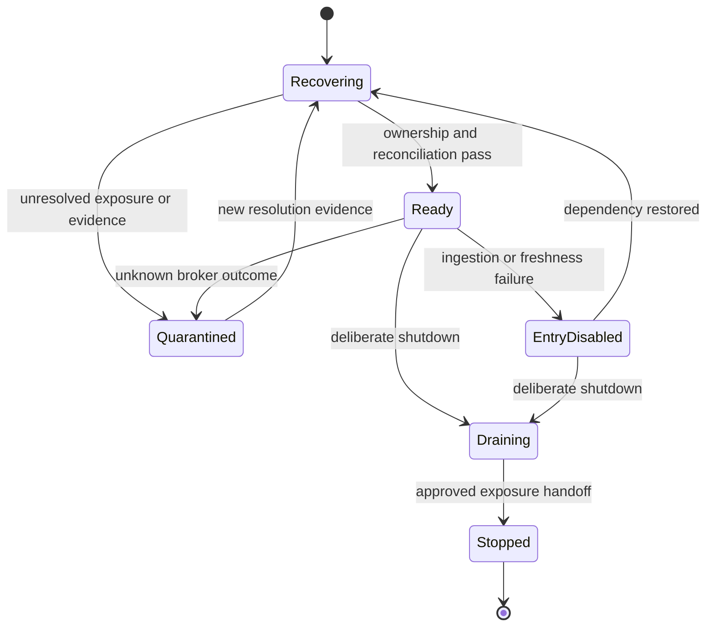

# Architecture and reliability improvement plan

## Consolidated deliverables A–G, improved design and offline test strategy

Date: 2026-11-12. Code baseline: `a4aac3a`. **Proposal only. No application rewrite, production deployment, live orders or real-funds validation.**

## Reviewed artifacts and missing information

The review covers eight application modules, thirteen test modules, dependency/configuration templates, Git baseline, supplied messages, [runbook](../OPERATIONS.md#daily-operation), narrative design and the six audit reports linked below. Existing source remains unchanged.

Available evidence supports concrete code/control-flow findings, not complete historical incident attribution. Still required for a complete audit: approved business rules; original message IDs/revisions/replies and reception times; timestamp-aligned exchange ticks and broker order/execution records; redacted effective deployment settings/runtime versions; service/permission/clock configuration; verified broker protection/correlation capabilities; execution prices/charges and approved accounting method. Do not supply secrets.

Critical clarification questions were sent for buying-range semantics, approved sizing and outage exit policy. **Unanswered or preselected options are not approval.** Other policy gaps remain Q01–Q22 in the requirements matrix. No guessed price-age threshold, risk budget, automatic liquidation or manual-position adoption policy is introduced here.

## Deliverable index

| Deliverable | Contents and evidence |
| --- | --- |
| A Executive assessment | Section A; [initial audit](ARCHITECTURE_RELIABILITY_AUDIT.md) |
| B Requirements gap analysis | Section B; [33-requirement traceability matrix](FUNCTIONAL_REQUIREMENTS_AUDIT.md) |
| C Technical defect register | Section C; [16 confirmed findings and 8 hypotheses](TECHNICAL_DESIGN_CODE_REVIEW.md) |
| D Failure scenario matrix | Section D; [22-scenario FMEA](FAILURE_MODE_EFFECTS_ANALYSIS.md) |
| E Improved system design | Section E; [current architecture review](SOLUTION_ARCHITECTURE_REVIEW.md), [contracts/invariants](DATA_OUTPUT_VALIDATION.md) |
| F Implementation roadmap | Section F |
| G Test plan | Section G |

These are one linked package. Overlapping findings are not separate production incidents. The prior 85-test pass and offline probes are recorded evidence; new tests proposed below have not been executed.

## A. Executive assessment

The system has useful confirmed-fill, cancellation-race, whole-lot sizing and strategy logic. Its orchestration does not yet establish predictable event handling, durable execution identity or safe unattended recovery.

Major risks are unknown broker effects after crashes/timeouts, loss of local protection on unrelated failures, dropped ticks, incorrect reply routing, cancellation resurrection and incomplete audit records. Current outputs cannot establish complete financial results.

Most likely systemic contributors to recurring defects: duplicated validators, implicit state, mock/live semantic differences, incremental patches without shared contracts, and persistence after side effects. These are source-supported architectural explanations, **not proof that every historical missed call had the same cause**. Prior incidents also include expired credentials and ceiling-sizing skips; one reportedly missed trade actually executed.

Retain working mechanisms and repair boundaries incrementally. Neither a wholesale rewrite nor microservices are justified by current evidence.

## B. Requirements gaps

| Category | Examples | Disposition |
| --- | --- | --- |
| Missing capability | R24 startup reconciliation | Implement explicit recovery/admission gate |
| Ambiguous policy | R05 sizing, R07 range entry, R12 target allocation, R14 safest trailing | Owner decision and versioned acceptance examples |
| Contradiction | Ceiling versus floor; obsolete T3 closure instructions; sticky mode versus session window | Canonical current requirements; historical documents clearly archived |
| Implementation mismatch | R18 reply routing, R19 cancellation, R22 queue identity | Targeted regression and correction |
| Not verifiable | Every historical miss; optimal trailing; financial accuracy | Obtain appropriate source evidence/ledger; retain unknown status |

The [matrix](FUNCTIONAL_REQUIREMENTS_AUDIT.md) maps intent, clarity, edge cases, code, exceptions and measurable acceptance criteria. Blocking policy questions must not be counted as passing tests or silently answered by implementation.

## C. Defect disposition

| Class | Findings | Action |
| --- | --- | --- |
| Coding | TD01 unread ticks, TD02 latched error, TD03 unrelated reply, TD04 cancelled assembly, TD08 parser disagreement, TD09 fill coercion | Small failing regressions then producer corrections |
| Design | TD05 lost identity, TD07 failure coupling, TD11 no recovery, TD12 late persistence, TD13 stale-feed gap | Durable workflow and explicit ownership/state/isolation |
| Design/policy interaction | TD06 amendments, TD10 session admission | Preserve valid state; resolve policy before certifying behavior |
| Local lifecycle/privacy | TD14 API sockets, TD16 auth output | Targeted resource/redaction fixes |
| Suspected risks | H01 writer race, H02 starvation, H03 blocking transport, H04 token writer race | Execute specified experiments before claiming confirmation |

Full root causes, triggers, severity, evidence and regression specifications are in the [technical register](TECHNICAL_DESIGN_CODE_REVIEW.md). Confirmed code paths are not necessarily reproduced production failures.

## D. Failure coverage

| Scenario group | Existing evidence | Planned tests |
| --- | --- | --- |
| FM01–03 timeout/throttle/network | Unknown-submit tests; reconnect probe | X06/X08/X11 |
| FM04–06 duplicate/out-of-order/stale | Cumulative duplicate tests; tick-loss probe | X02/X03/X07 |
| FM07–10 instrument/rejection/partial/delay | Metadata, rejection and cancel-race tests | X04–X06 |
| FM11–14 crash/termination/storage/restart | Source gaps; no full recovery suite | X08–X10 |
| FM15–18 drift/duplicates/clock/auth | Memory dedup and auth tests | X03/X10/X11 |
| FM19–20 malformed/conflicting | Fill/routing probes and cancel-race tests | X01/X05/X09 |
| FM21–22 financial/audit gaps | Missing ledger/provenance confirmed | X14/X15 |

The [FMEA](FAILURE_MODE_EFFECTS_ANALYSIS.md) supplies trigger, impact, detection, containment, recovery and residual risk. Existing tests cover only identified cases, not each entire scenario group.

## E. Improved system design

### E1. Components: modular monolith, one execution owner

These are logical modules, not separate services. All order writes pass through one manager; supervision must not create a competing writer.

| Boundary | Responsibility | Retain / change |
| --- | --- | --- |
| Composition root | Immutable validated settings, injected clocks/ports, mode/lifecycle | Evolve CLI; remove import-order configuration dependencies |
| Ingestion/inbox | Source revisions, durable dedup/cursor, bounded catch-up | Retain Telethon; preserve typed envelopes |
| Signal coordinator | Reply-keyed assembly, amendments, cancellation, scheduling | Reuse syntax; one domain validator |
| Instrument/risk | Metadata, funds observation, session and allocation gates | Retain Decimal sizing; separate private symbol loader |
| Strategy reducer | Pure state/event -> next state and proposed intents | Preserve working formulas; extract I/O incrementally |
| Order manager | Intent dispatch, fills, cancellation, reservations, unknown outcomes | Preserve confirmed-fill/cancel-race protections |
| Market adapter | Ordered events, connection generations, freshness/overflow | Correct current waiter; same contract for mock/live |
| Store | Inbox, intents, events, projections, migrations | Keep SQLite initially; preserve old rows |
| Recovery/ownership | Exclusive execution and broker/local reconciliation | New admission gate; no automatic foreign-position adoption |
| Exposure supervisor | Protection health independent of ingestion | Approved actions through same order manager |
| Observability/API | Correlated diagnostics and read-only projections | Fix socket lifetime locally; truthful distinct health states |

### E2. Dispatch sequence and uncertainty

Commit decision/intent and aggregate version atomically before dispatch. Record dispatch attempt before network I/O. After a crash, an attempted intent is uncertain until resolved, not automatically retryable. Broker correlation/tagging must be verified; a tag is not assumed broker-enforced idempotency. If matching is ambiguous, quarantine.

If storage fails while recording UNKNOWN, the earlier committed intent/attempt remains evidence. Report persistence failure separately; never claim an unsuccessful write was durable. No local transaction makes broker submission exactly-once.

### E3. Data flow and contracts

Adopt the versioned contracts and DI01–DI20 in [data validation](DATA_OUTPUT_VALIDATION.md). Require stable account/source/signal/intent/event IDs, source references, config/rule/build versions and explicit source/receipt/recorded times. Strict integers reject booleans/fractions; monetary/tick representation must be explicit. ACK, decision LTP, requested limit and execution price are distinct fields. Missing values remain unknown, not zero.

SQLite can support the initial single-writer design with migrations and tested backup/restore. Legacy snapshots remain historical evidence; do not manufacture event histories or auto-restore unsupported old positions. Manual/reentry/queued paths use the same lifecycle contracts. Raw secrets never enter the audit ledger.

### E4. Explicit states

EntryDisabled/Quarantined do not imply flat or automatically liquidated. Every restart begins Recovering; a crash may bypass graceful states.

| Aggregate | Guarded state model |
| --- | --- |
| Signal | ASSEMBLING -> VALIDATED -> ARMED; CANCELLED/EXPIRED/REJECTED terminal for that revision |
| Order | INTENT_RECORDED -> DISPATCHING -> ACKNOWLEDGED -> PARTIAL/FILLED; CANCEL_REQUESTED -> CANCELLED or FILLED; UNKNOWN -> reconciled outcome or quarantine |
| Position | FLAT -> OPEN only on positive confirmed fill; FLAT after attributed balance zero and no pending buy can refill |
| Protection | VERIFIED / DEGRADED / UNVERIFIED independent of admission; local monitoring is not broker-held protection |
| Report | COMPLETE / PROVISIONAL / INCOMPLETE based on evidence, not console success |

Rejected/cancelled terminal orders retain cumulative fills; they may leave an open position. Amendments either validate atomically or create a nontradable draft. Duplicate events are audited no-ops. One broad trade status must not hide order/exposure/protection differences.

### E5. Fault isolation and recovery

| Failure | Containment | Recovery |
| --- | --- | --- |
| Invalid command | Reject locally, no state mutation | New/corrected revision; healthy protection continues |
| Ingestion loss | Disable affected new signals | Durable catch-up without stale-entry replay |
| Stale market | Entry disabled; protection degraded | Freshness/reconnect checks and approved outage response |
| Read timeout/throttle | Bounded classified retry/request budget | Fresh observations; no false empty account |
| Unknown write | Block conflicting action; reserve uncertain exposure | Broker evidence, not blind retry |
| Database loss | Block uncommitted dispatch; explicit uncertainty | Restore and reconcile accepted effects |
| Auth loss | Not ready for dependent actions; redacted alert | Refresh/rebuild adapters and reconcile |
| Account discrepancy | Quarantine affected allocation | Attribute or obtain operator resolution |

Recovery sequence: acquire ownership; load unresolved intents; successfully fetch broker orders/trades/positions with as-of times; compare per intent/account/product/symbol; restore only uniquely supported state; quarantine unknown/manual exposure; record outcome before enabling admission. Broker request failure is never interpreted as flat.

Initial tested OS process lock can enforce single-host ownership; it does not exclude another host or manual trader. Distributed failover needs proven fencing and broker-aware reconciliation. Do not add automatic failover merely because a service manager exists.

Logical task isolation cannot survive host death by itself. Validate any broker-held protective capability and independent watchdog separately. No automatic liquidation policy or live capability is assumed here.

### E6. Rationale and trade-offs

| Improvement | Why | Trade-off |
| --- | --- | --- |
| Targeted fixes | Remove reproduced defects with small review scope | Cannot alone solve crash recovery |
| Modular monolith | Local transactions, fewer new dependencies | Shared host remains failure domain |
| Pure reducer | Deterministic replay and state testing | Extract gradually to preserve working semantics |
| Inbox/intents/events | Identity, audit and recovery | Storage/migration cost; no guaranteed exactly-once external API |
| Bounded ordered events | No silent loss; explicit overload | Overflow/freshness policy needed; unlimited tick retention not assumed |
| Typed ports/settings | SDK isolation and reproducible config | Strict schemas need versioned compatibility tests |
| Separate protection/admission | Ingestion rejection need not kill monitoring | More states; outage policy still required |
| Retain SQLite/unittest | Proportionate change and existing knowledge | Enforce single-writer scope and test supported runtimes |

No Kafka, new broker library, full accounting rewrite or microservice decomposition is proposed without a demonstrated requirement. API cleanup and redaction remain local corrections.

### E7. Observability

Measure cursor gaps, queue age/depth, last-valid-tick age, ownership, unknown-intent age, order/cancel confirmation age, broker drift, protection coverage, storage/auth readiness and build/config versions. Alerts for unknown dispatch, failed protective exit, stale feed with exposure, ownership loss and persistence failure carry redacted correlation IDs and recovery state.

Define independent liveness, entry readiness and protection health. Test alert delivery failures. Numeric deadlines/SLOs are configurable policy decisions, not invented achievements.

## F. Implementation roadmap

Stages authorize only further offline engineering review, not live deployment.

| Stage | Work | Dependencies | Validation gate |
| --- | --- | --- | --- |
| F0 | Preserve baseline; isolate tests; version decisions/contracts | Existing artifacts | Reproducible baseline, no network/secrets/real DB access |
| F1 | TD11 startup gate and single-owner exclusion; refuse unresolved legacy state | F0/mock broker | Idempotent reconciliation; second owner denied; zero blind retry |
| F2 | TD01–04/08/09 targeted fixes; TD07 rejection isolation; TD14/16 local cleanup | Reproducing tests; relevant policy answers | Before-fail/after-pass plus baseline; no unrelated changes |
| F3 | TD05/12 durable typed queue, intents/events and lineage; metadata/config ports | F1, migration/backup tests | Crash matrix, identity preservation, partial/cancel safeguards |
| F4 | Atomic amendment/session rules, reducer extraction, stale-feed/isolation, bounded catch-up | F2/F3 and policy decisions | Fault/state/E2E tests; valid exposure management survives invalid input |
| F5 | Supported automatic restoration, drift handling, report completeness | F3/F4, ownership/accounting rules | Rebuild deterministic state; no fabricated financial results |
| F6 | Canonical entrypoints/runbook, dependency reproducibility, runtime CI, alerts | Prior gates | Compatibility, migration, resource and redaction evidence |

F1 is a refusal/reconciliation gate before full automatic restoration. It must not pretend legacy snapshots contain sufficient recovery evidence. Independent narrow fixes can proceed without waiting for unrelated policies.

Each change set maps R/TD/FM IDs, adds a meaningful failing test, applies smallest correct fix, runs focused/full suites, reviews emergency/cancellation consequences and records residual risk. Preserve existing journal originals; migrations require rollback or forward-repair plans. Do not recommend deploying changes to live trading.

## G. Comprehensive non-executing test plan

### Harness and isolation

- Use isolated environment/temp home, token/journal paths and synthetic credentials; prevent dotenv discovery of production secrets.
- Inject broker, market, clock, inbox and store ports. A fake broker keeps independent durable accepted-order state across simulated engine crashes.
- Deny external network egress and install a sentinel real adapter that fails on construction/dispatch. Mock flag alone is insufficient proof of isolation.
- Use supplied messages with explicit synthetic reply IDs and labeled synthetic prices; historical real prices only when provenance exists. Never infer exchange ticks from channel progress.
- Use virtual clocks, seeded schedules and fixture hashes. Preserve original85 tests; don't change expectations simply to make failures green.

### Scenarios, results and pass/fail criteria

| ID / category | Scenario | Required result |
| --- | --- | --- |
| X01 Unit/contract | Parser parity, strict values, atomic amendments; TD06/08/09 | Same accepted model across ingress; reject null/bool/fraction/NaN before mutation; no armed invalid draft |
| X02 Event integration | Unread ticks/bursts, stale feed, reconnect; TD01/02 | Ordered delivery or explicit overflow; reconnect accepts fresh ticks; no silent loss |
| X03 Integration/idempotency | Split/interleaved replies, cancellation, duplicates/restart; TD03–05/15 | Exactly one accepted revision; no resurrected cancellation, wrong-trade mutation or stripped queue identity |
| X04 Unit/contract | Funds/lot/cap/reserve, symbol expiry/tick | Exact approved symbol/quantity; error -> zero intent; independent arithmetic oracle |
| X05 State transition | ACK/pending/partial/full/rejected, repeated fill, cancel race | ACK0 -> position0; repeat30 ->30; full100 ->100; terminal-cancel replacement only unsold balance |
| X06 Fault injection | Lost ACK, delayed row, throttling, cancel timeout | Bounded policy; unknown not retried as new; rejected exit never reports flat |
| X07 Property/state | Generated admissible/reordered events | No oversell/negative allocation; monotonic fill; ratcheting stop; duplicate no-op; invariant violation fails |
| X08 Recovery/fault | Crash at commit/dispatch/ACK/fill/snapshot | No duplicate accepted effect; restored supported state or explicit quarantine; admission disabled until reconciled |
| X09 Concurrency | Two owners, conflicting exit/cancel/amendment, writer contention | One dispatcher; stale update rejected; no excessive sell or wrong allocation |
| X10 Reconciliation | Manual trade, external square-off, foreign order | Drift detected; foreign exposure not adopted/flattened; repeated reconciliation idempotent |
| X11 Clock/auth/isolation | Session boundary, clock step, expiry, Telegram failure | Approved submission-time policy; no secret leak; invalid input/ingestion failure does not inherently kill healthy protection |
| X12 Resources/alerts | API success/error repetition, reconnect, failed alert delivery | Bounded resources and cleanup; truthful health; no secrets; alert failure observable |
| X13 E2E simulation | Nov11/12 message fixtures, synthetic ticks, delayed fills/commands | Exact expected disposition/intent/fill ledger; not every channel claim assumed executable; zero external calls |
| X14 Financial reconciliation | Multi-price partial fills, duplicates, missing fees/marks | Quantity correct; missing financial input explicitly incomplete; P&L oracle only after accounting policy approved |
| X15 Audit/regression | Manual/direct/queued/reentry, crashes, corrections | Every effect traces to origin/rule/intent/evidence; corrections append; no false completeness |
| X16 Compatibility/migration | Supported runtimes and old journal fixtures | Original data preserved; migration safe/rejected clearly; unsupported history quarantined |
| X17 Harness safety | Attempt real adapter/network/production token access | Guard rejects before any side effect; any forbidden access fails suite |

Concrete oracles: buy100 and sell70 racing cancel permits replacement30 only after terminal confirmation; sold100 permits no replacement. CANCEL before final targets permits zero entry. Source1/2/3 plus reply999 changes nothing absent proven mapping. Funds10000/price94/lot20 currently characterizes floor100, not implicit policy approval. Missing execution price permits quantity report but never invented realized cost/profit.

### Acceptance gates

1. **Safety:** zero live-order, real-funds, production-secret/database or external-network access; fail the run on any forbidden path.
2. **Baseline:** original85 tests retained/pass unless a separately reviewed changed requirement justifies a transparent replacement; no hidden regression deletion.
3. **Critical invariants:** all named transition/crash cases relevant to changed paths pass; zero duplicate dispatch, oversell, wrong-target mutation or false flat/ready state.
4. **Recovery:** every external-effect boundary resolves idempotently or remains explicitly unknown; never adopt unsupported exposure by assumption.
5. **Determinism:** identical accepted inputs/config/clock/schedule yield identical normalized ledger/decisions.
6. **Traceability:** all outputs join to origin/rule/events or explicit missing-evidence state; paper/live distinguished.
7. **Policy:** missing critical answer is BLOCKED, not green. Numeric thresholds need approved values before acceptance.
8. **Compatibility:** runtime/schema versions actually exercised are recorded; no claimed matrix from one interpreter run.

No arbitrary coverage percentage substitutes for named critical transitions. Optional mutation tests should catch ACK-as-fill, bypassed cancel confirmation, lost identity and real-adapter invocation. Record commit, runtime/dependencies, fixtures/hashes, seed, policies, executed IDs, count/exit code, isolation result and skipped/blocked cases in a run manifest.

**Execution status:** prior audit ran85 tests and documented specific probes. None of X01–X17 is claimed newly implemented/executed here. This plan creates no tests or application changes.

## Diagram and handoff status

Mermaid validation was attempted but requires sign-in; automated syntax validation is not claimed. Diagram previews were requested. Tables/text are the normative design if the reader cannot render diagrams. These models are proposed, not extracted implemented architecture.

The package is ready for policy review and scoped offline implementation planning. It does not recommend live-trading deployment. The first concrete engineering task remains startup reconciliation/ownership gating, alongside targeted reproduced-defect fixes and durable-intent design.
